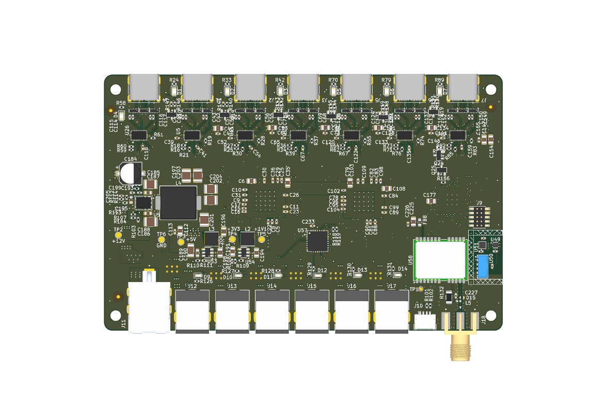

# scope_hub

Telescope power and USB hub: six 12V/4A outputs, six 5 Gbit/s USB-C ports supplying 5V/2A, all ports support
switching, pwm control, and current monitoring. It also has a GPS, environment sensors and a Qwiic 
port. One of the six USB ports supports 5A to power a raspberry pi 5. Controled as a USB-HID device.

| Directory | Contents | License |
|---|---|---|
| `firmware` | RP2350 firmware | AGPL-3.0 |
| `driver` | Go driver and `scopehub` command | AGPL-3.0 |
| `pcb` | KiCad project | CERN-OHL-S-2.0 |
| `mech` | enclosure STEP files | CERN-OHL-S-2.0 |

See also the Alpaca switch driver is `scopehub` in [goalpaca-devices](https://github.com/mikefsq/goalpaca-devices).
